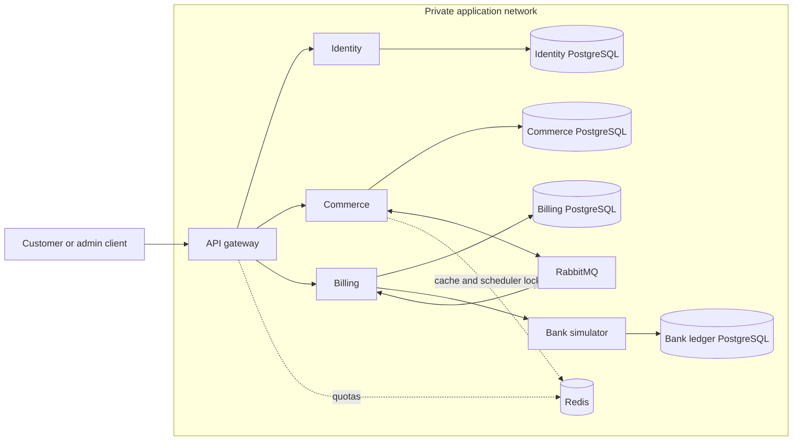

# Service separation and reliable communication

Status: private ownership, checkout/admission, outbox/inbox and payment-owned stock/Bank recovery are implemented. Billing owns financial results; Bank owns its durable deadline/no-charge fence; Commerce applies versioned projections and schedules local fulfillment jobs. See [payment contracts](PAYMENTS_AND_BANK_RECOVERY.md) and [evidence](PAYMENT_VERIFICATION.md). Fulfillment/refund execution comes next.

## Two different gateways

The API gateway is the client entry point for customer/admin API traffic: authentication checks, routing, request bounds, correlation IDs, deadlines and rate limiting. Domain services still enforce permissions and business rules. The payment gateway/bank simulator is the simulated financial boundary with stable charge/refund operations and a 15-minute pending-payment deadline. Their responsibilities and credentials are separate.

## Selected starting topology

Commerce contains Orders/Checkout/Catalog/Inventory and separate digital, subscription and physical processor modules. Effects, local item state, stock and cancellation guards share its SQL boundary. Billing owns payments/refunds and their logs; bank simulation has a separate durable ledger. OIDC Identity owns credentials and permissions. Commerce may have separate worker processes while retaining ownership and a combined resource budget. One repository, private network and PostgreSQL server with private databases/runtime roles are selected.

Fine-grained processor services are not selected for this MVP. A future split would make local effect and canonical order status separate commits and require additional cancellation/start fencing. Keep processors within Commerce now. No cross-service table writes, joins or credentials; no extra database technology is needed.

## Outbox is selected, not just an optimization

A service transaction writes its state change, local history and required outgoing message to its own SQL outbox. A publisher sends with RabbitMQ confirms and retries after crashes. The recipient stores its receipt/guarded effect/result outbox locally, then acknowledges. No SQL transaction spans RabbitMQ or two service databases. This follows the [transactional outbox pattern](https://docs.aws.amazon.com/prescriptive-guidance/latest/cloud-design-patterns/transactional-outbox.html).

Example: Commerce accepts an order and payment initiation. Its transaction writes PaymentRequested to its outbox. Billing deduplicates that request, records a stable payment operation and calls the bank idempotently. Billing commits PaymentSucceeded plus a result outbox row. If Commerce is unavailable, the result remains deliverable; Commerce later applies it once and schedules item work. A Billing success and the Commerce view are temporarily different observations, not one global commit.

Use outbox for order/preparation commands, reservation results, payment/refund results, fulfillment results and cancellation coordination where those cross owners. For a purely local call with no outgoing message requirement, no additional outbox event is necessary. It supplements SQL business constraints; it does not prevent duplicate bank operations by itself.

## Selected communication approach

- Synchronous HTTP for bounded authenticated reads or operations requiring an immediate authoritative reply. Timeouts produce explicit pending/error outcomes; no locks are held while waiting for a remote service.
- RabbitMQ for durable commands and results. Each owner uses dedicated queues/routing permissions, bounded prefetch, backoff and dead-letter handling. Do not add generic middleware services merely to relay messages.
- Message envelope: event/command type and schema version, message ID, operation ID, aggregate ID, workflow generation, producer, correlation/causation IDs and timestamp. Minimal necessary payload; immutable monetary snapshots on financial commands.
- Each owner authorizes commands, validates versions and applies state guards. Out-of-order events cannot regress state or reopen succeeded/refunded work. SQL inbox/receipts protect duplicate handling but do not replace domain operation uniqueness.
- Producer publishing rights and consumer queue rights are scoped by service. Private network membership is not permission to send a fake PaymentSucceeded result.

## Transaction and ownership map

| Earlier shared-SQL sketch | Service-separated requirement |
|---|---|
| Order and payment success updated together | Billing owns the result; Commerce applies a versioned payment projection and schedules items in a later local transaction |
| Refund budget checked by locking order/payment/items | Billing enforces global captured/refundable monetary budget; Commerce protects item disposition and sends stable authorized refund commands |
| Foreign keys join every domain | Local FKs only; cross-owner IDs are logical references validated through contracts |
| Order detail joins all tables | Commerce projection and/or bounded API composition; expose source version/pending freshness |
| Cancel and all item claims share parent lock | Retained within selected Commerce; cancellation cutoff is first fulfillment start |
| All history writes in one transaction | Each owner writes local history with its state; a combined view is correlated and eventually updated |
| One outbox/recovery process | Each state owner has an outbox and recovery responsibility; workers may share code, not unrestricted DB credentials |

Refund coordination guards both owners: Commerce commits a unique immutable item disposition and RefundRequested command, blocking fulfillment; Billing deduplicates disposition identity and enforces refundable budgets. Versioned results apply once. Lost/repeated messages reuse identities and never create a second obligation. This handshake needs implementation/crash evidence; the diagram alone is not proof.

Gateway entry atomically promotes Commerce stock to PAYMENT_PENDING with its payment-command outbox. Stock stays held across command delay/unknown bank status. Authoritative success changes it to ALLOCATED; failure releases it. Cancellation requires Billing no-charge acknowledgment/tombstone before release if a delayed original command could still charge. Already uncertain operations reconcile and refund success without dispatching items.

## Network and operations

Expose the client gateway, with required Identity browser endpoints reverse-proxied through controlled routes. Keep domain APIs, DB ports, Redis, RabbitMQ and management private; development bindings are loopback-only. Services use authenticated channels/least-privilege identities. TLS/session/service identity follows SECURITY.md; network isolation is not authentication.

Each service has separate health/readiness, logs, connection pools, worker limits, migrations and startup scripts. Carry correlation IDs across HTTP, outbox, RabbitMQ and bank lookups. Watch queue depth, outbox lag, oldest unresolved financial outcome, expired holds, retries/review and per-service saturation. Configure timeouts and shutdown/draining so a crashed deployment leaves recoverable work.

Compose service DNS and polling outbox publishers are initial implementation defaults. No Kubernetes, service mesh, CDC or discovery server is needed for this topology. Static Persian UI adds no SSR service. The entire stack uses the 8 GB/4-core envelope in CAPACITY_AND_SCALING.md, subject to startup/load verification.

## Read consistency, identity and capacity

Commerce coordinates workflow and owns the eventual progress view with Billing source versions. Bounded synchronous reads may supplement it; a timeout cannot become a final financial outcome. Current-status replay reads Commerce's current state. All APIs derive ownership from verified identity and authenticate internal commands/results.

Q11–Q21 are selected. Package versions, numerical defaults and measurements remain engineering work. Reject excess new work before acceptance, protect existing workflow controls/recovery, and never use broker eviction to shed accepted work. See CAPACITY_AND_SCALING.md for admission/scale-up, SECURITY.md for API controls and UI_SCOPE.md for the Persian flow brief. The assignment's 5–7-day estimate does not establish an estimate for expanded scope.
