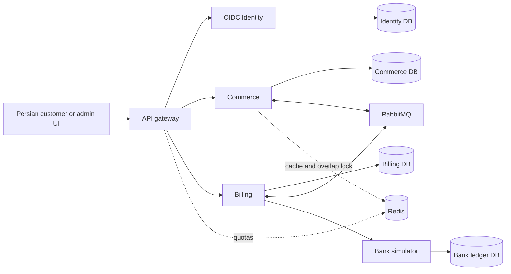

# Backend system design

Status: this is the selected target design. Steps 1-4 implement private services, identity/admin APIs, checkout/admission, reliable messaging and payment/Bank recovery with durable fulfillment dispatch. Typed fulfillment/refund execution and public cancellation remain later. See [PAYMENTS_AND_BANK_RECOVERY.md](PAYMENTS_AND_BANK_RECOVERY.md) and [PAYMENT_VERIFICATION.md](PAYMENT_VERIFICATION.md).

## Services and ownership

Use one NestJS/TypeScript repository with separately runnable API Gateway, Commerce, Billing and Bank simulator services, plus a maintained OIDC Identity provider. One private application network; client traffic enters through the gateway. Serve the small Persian UI statically through the gateway. Three separate product processor modules live inside Commerce, preserving local SQL transaction boundaries.



Use one PostgreSQL server initially with isolated databases/runtime roles. Prisma handles ordinary persistence; parameterized SQL and custom migrations handle required locking, constraints and unconstrained money. No cross-service table writes, joins, foreign keys or global SQL transaction. Each owner commits local state/history/outbox and consumes remote results idempotently.

| Owner | Authoritative data |
|---|---|
| Identity | Credentials, roles, sessions and identity lifecycle |
| Commerce | Catalog, inventory/adjustments, checkout revisions, orders/items, reservations, entitlements/extensions, shipment evidence, item disposition, review cases and order history |
| Billing | Charge/refund operations, refundable budgets, attempts, financial logs, provider references and reconciliation schedule |
| Bank simulator | Independently committed idempotent charge/refund ledger and payment deadlines |
| Each state owner | Local outbox, consumer receipts, workflow versions and recovery |

Commerce maintains eventual financial projections from Billing results; Billing is monetary authority. Q06 replay returns current committed Commerce progress. A delayed projection explicitly shows pending/source version; it is not a global simultaneous snapshot. See [SERVICE_ARCHITECTURE.md](SERVICE_ARCHITECTURE.md).

## Invariants

1. Authenticated customer/operation/request key identifies one logical create request. Changed payload conflicts; replay never renews stock or repeats a successful effect.
2. Product type/name/price/duration and total are server-owned snapshots. Paid snapshots never mutate.
3. Fulfillment needs authenticated authoritative payment success applied to the correct order/revision and no accepted cancellation/refund disposition.
4. Sellable stock stays nonnegative. Each reservation generation allocates/releases/consumes once; stale messages cannot release a later or payment-promoted allocation.
5. Digital grant evidence, subscription extension and shipment effect are unique per paid item. Effects, local result/history/outbox commit together.
6. Captured/refundable budgets are enforced by Billing; duplicate commands/results cannot overcharge or over-refund. Commerce cannot both fulfill and commit the same item to refund resolution.
7. COMPLETED requires all required items succeeded. Returning money is a separate financial result; failed items do not become fulfilled because a refund succeeded.
8. Accepted workflows remain durable through pressure/restarts; new work is rejected before admission when capacity is insufficient.
9. Redis loss/expired overlap locks cannot break any invariant.

## Exact large IRR money

All prices, totals, charges and refunds are whole IRR (rial), represented externally as canonical decimal strings. No business amount ceiling. Arithmetic uses TypeScript BigInt for nonnegative integers; never JavaScript Number or binary floats. Normalize Persian digit input at the UI/API edge, validate canonical integer strings and reject fractions/exponents/nonfinite values.

Use PostgreSQL NUMERIC without declared precision/scale plus constraints ensuring finite nonnegative integers. Unconstrained NUMERIC supports large exact values up to implementation limits ([PostgreSQL numeric documentation](https://www.postgresql.org/docs/current/datatype-numeric.html)). Explicitly reject NaN/Infinity/-Infinity; integer equality/truncation alone does not establish finiteness. Do not substitute BIGINT or NUMERIC(65,30) as a hidden cap.

Financial SQL adapters bind decimal strings, cast to NUMERIC, and return amounts as text. Review custom migrations and ORM introspection so a later migration does not impose default precision. Avoid relying on a decimal library's default arithmetic precision. Ordinary Prisma entities remain conventional; exact money paths get explicit SQL/string adapters and round-trip tests. Reject technical oversized requests explicitly, never silently round/clamp them. Optimize by parsing once, using exact integer addition/multiplication and indexing IDs/status/due times rather than enormous monetary fields.

## Main states

| Entity | State model |
|---|---|
| Order workflow | CHECKOUT_RESERVED, CHECKOUT_EXPIRED, BASKET_CHANGED, PAYING, PAYMENT_REVIEW, PROCESSING, ATTENTION_REQUIRED, MANUAL_REVIEW, CANCELLATION_PENDING, PAYMENT_FAILED, COMPLETED, CANCELLED; final mixed-resolution display maps to item/refund state |
| Item | PENDING, PROCESSING, RETRY_WAIT, SUCCEEDED, FAILED, MANUAL_REVIEW, CANCELLED; explicit disposition guards fulfillment versus refund |
| Payment | PENDING, PROCESSING, UNKNOWN, SUCCEEDED, FAILED |
| Reservation | ACTIVE checkout hold, PAYMENT_PENDING, ALLOCATED paid stock, CONSUMED, EXPIRED, RELEASED, DISPUTED/correction disposition |
| Refund operation | PENDING, PROCESSING, UNKNOWN, SUCCEEDED, FAILED, REVIEW_REQUIRED |
| Financial summary | NONE, PARTIALLY_REFUNDED, REFUNDED, based only on confirmed returned money |

Final enum spelling is an implementation detail; transitions must preserve the selected distinctions. A failed line with settled partial refund is not COMPLETED. Manual review is not proof that an item is permanently unfulfillable. Use durable review cases alongside the item's reason/state.

## Checkout, payment stock and basket revisions

Final checkout atomically allocates physical stock for five minutes using database time. Return expires_at and revision for the Persian UI. Duplicate physical lines merge; digital/subscription lines are unique and quantity 1.

Gateway entry locks the order/items/inventory/reservations. If checkout expired, settle release once and reacquire against current stock; if unavailable, revise quantities downward/remove zero-quantity lines, return BASKET_CHANGED with reasons/new totals/revision/expiry and require confirmation. Paid snapshots remain immutable; a stale request cannot charge the previous amount.

For a confirmed payable revision, promote its holds to PAYMENT_PENDING and insert the stable PaymentRequested outbox command in the same Commerce transaction. This is the selected extension/reapplication: checkout's five-minute expiry no longer applies. Keep stock protected during delayed command delivery, bank processing or UNKNOWN result. Do not hold SQL locks while contacting Billing/bank.

On authoritative success, Commerce changes PAYMENT_PENDING to ALLOCATED and schedules typed item work atomically with applying the result. Success does not replenish stock. On definitive failure, release eligible holds once; on accepted cancellation route success to refund rather than fulfillment. After shipment, mark allocation CONSUMED without decrementing sellable stock again.

A stale checkout-expiry event matches only ACTIVE + due generation, never PAYMENT_PENDING/ALLOCATED. If no bank operation has started and cancellation is accepted, Billing must durably acknowledge no-charge/cancel that payment identity before Commerce releases its payment-owned stock; delayed original commands must remain no-ops. Unknown outcome never permits guessed release. Persist the cancellation/no-charge tombstone even if it arrives before the original PaymentRequested command.

## Data model and indexes

| Database | Principal tables and correctness keys |
|---|---|
| Commerce | products, inventory (available >= 0), inventory_adjustments; checkout_revisions; orders; order_items; create_requests UNIQUE(customer, operation, key) with fingerprint; reservations UNIQUE(item, generation) and one live allocation; digital_entitlements UNIQUE(customer, product), digital_grants UNIQUE(item); subscriptions UNIQUE(customer, product), subscription_extensions UNIQUE(item); shipments UNIQUE(item/reservation); item_dispositions UNIQUE(item, resolution_generation); order_events; review_cases |
| Billing | payment_requests/payment operations UNIQUE(order/payment identity); payments with immutable amount/currency/revision; attempts; refund_requests UNIQUE(disposition identity); refunds UNIQUE(operation key); refund_item_allocations; append-only refund_logs; reconciliation due times; no-charge/cancellation tombstones |
| Bank | charge operations UNIQUE(payment key), initiated_at/deadline_at, immutable terminal outcome; refund operations UNIQUE(refund key) referencing captured operation and capped total |
| Each owner | outbox UNIQUE(kind, aggregate, generation); receipts UNIQUE(consumer, message_id); stable business operation IDs independent of transport message ID |

Use local FKs and explicit deletion rules; preserve financial/history evidence. Checks enforce positive physical quantities, nonnegative integer money, valid types/states and required type metadata. Cross-table invariants require guarded transactions or explicit schema mechanisms, not a CHECK pretending to query another owner.

Indexes: owner/date/id and status/date/id order pagination; item(order_id,status); due-work/reconciliation/outbox partial indexes; ACTIVE reservation expiry index; history(order_id,time,id); refund history(payment/order reference,time,id). Live-reservation uniqueness uses explicit state, not a time-dependent predicate. Account for all Node/process pools inside the host budget.

## SQL/pseudocode: idempotent creation

These are algorithm sketches; executable migrations/SQL will be implemented and tested. A pending admitted order consumes a shared Commerce SQL admission slot; duplicates do not consume another.

```text
validate authenticated customer and normalize request quantities
fingerprint = hash(canonical logical request, excluding current catalog price)
BEGIN READ COMMITTED
  claim UNIQUE(customer, create-order, key), including fingerprint/new order ID
  // Use deferred local FK if key row precedes order; migrate it explicitly.
  if conflict:
    compare stored fingerprint; changed -> conflict
    return existing order ID/current Commerce status; do not renew hold
  atomically acquire available admission slot or reject before acceptance
  read authoritative catalog; compute exact IRR snapshots
  insert order/items/current checkout revision
  reserve physical lines in consistent resource order; insert expiry work/history
  insert preparation outbox; no charge before explicit gateway entry
COMMIT
```

Unique insertion arbitrates concurrent identical requests; do not implement SELECT-then-INSERT without the constraint. Payment ledger creation occurs later inside Billing's own transaction, never as a cross-database FK/write from Commerce. A rejected allocation/admission rolls back its key/order slot as appropriate; revision editing is a separate guarded transaction.

## SQL/pseudocode: concurrent stock reservation and release

Lock Commerce resources consistently: parent order, items by ID, inventory by product ID, reservations by ID. Admin corrections/expiry/cancellation use that order too; scanners discover candidates before acquiring parent locks. Keep transactions short.

```sql
BEGIN;
SELECT id FROM orders WHERE id = :order_id FOR UPDATE;
-- Lock current items/inventory/reservations in stable order; validate revision.
UPDATE inventory
SET available = available - :quantity
WHERE product_id = :product_id AND available >= :quantity
RETURNING product_id;
-- Missing row => allocation attempt rolls back; revise basket separately.
-- Otherwise insert ACTIVE reservation with unique generation,
-- expires_at = database_time + interval '5 minutes', history and expiry work.
COMMIT;
```

If any requested revised line cannot allocate, roll back the entire attempt. A uniqueness failure must also roll back its decrement. Release is a guarded state transition plus a single increment of valid sellable quantity, with history in that same transaction. Admin-confirmed nonexistent units use a correction/quarantine disposition rather than ordinary release. Payment promotion changes state under the same locks; a delayed expiry cannot undo it.

## SQL/pseudocode: claim and complete an item

```text
BEGIN
  lock parent Commerce order, item, then inventory/subscription/resource rows
  if receipt exists, item SUCCEEDED, or old work generation: guarded no-op
  require successful payment projection for same revision and paid allocation
  reject accepted cancellation or item committed to refund resolution
  require current due generation; defer early/prerequisite work durably
  record started transition/real attempt count
  execute local product effect + unique per-item evidence
  // Digital: unique entitlement plus item grant evidence.
  // Subscription: lock customer/product subscription, extend fixed days
  // from max(expiry, database time); unique extension per paid item.
  // Physical: consume ALLOCATED stock and create unique shipment;
  // no second decrement of sellable inventory.
  mark item succeeded, write history/receipt/result outbox
  recompute aggregate under parent lock
COMMIT; ACK
```

No remote call or sleep while locks are held. Local failures roll back effect/evidence; a fresh guarded transaction records retry/failure if the state still permits it. Infrastructure outage before execution starts does not spend a business attempt. Same-order item transactions serialize briefly; different orders contend only on shared resources.

## SQL/pseudocode: aggregate order outcome

```text
lock Commerce parent order first for every item/retry/cancel/result transition
if cancellation accepted: preserve pending/final cancellation resolution
else if payment definitively failed: PAYMENT_FAILED
else if payment unknown: PAYING or visible PAYMENT_REVIEW; keep reconciliation
else if all required items succeeded: COMPLETED
else if runnable/deferred item work remains: PROCESSING
else if item resolution needs human action: MANUAL_REVIEW / ATTENTION_REQUIRED
else: expose mixed item/refund resolution; never claim all fulfilled
write transition history only if changed
financial projection: confirmed refunds 0 -> NONE;
0 < returned < captured -> PARTIALLY_REFUNDED; returned == captured -> REFUNDED
pending/unknown refund amounts stay separate
```

Read aggregate items after acquiring the parent lock under READ COMMITTED. This prevents two final workers each seeing the other as unfinished. Billing confirms financial totals; Commerce cannot fabricate a final refund result from its own pending request.

## Bank operations and financial recovery

Billing deduplicates PaymentRequested, records immutable operation identity/amount/revision and calls the bank outside transactions. Bank atomically creates/returns the same operation. Its first durable initiation fixes a 15-minute deadline; terminal success/failure is immutable. At deadline a still-pending operation fails, and cannot later charge. Deadline/start/success races serialize at the provider ledger.

Missing response means UNKNOWN. Billing persists increasing-delay lookup work for the same key until outcome, capped between lookups with a deadline lookup. A late read of an already successful operation remains success. If the bank cannot be reached at minute 15, Billing does not guess failure or release stock. Record success/failure plus Billing history/result outbox atomically; Commerce applies results by operation/version once.

Payment cancellation/tombstone handling is explicit: if no provider operation exists, Billing serializes charge-start versus cancel and acknowledges no-charge only when no later command/call can start one. If already in flight/uncertain, reconcile and refund on success. An early cancel command must block a later reordered charge command.

## Whole-line refunds and cancellation

Commerce marks a confirmed unfulfillable line with a unique refund disposition under its item/order lock, preventing fulfillment retry. Commit RefundRequested plus history/outbox. Billing deduplicates the disposition, reserves its refundable budget under payment lock, and creates a stable bank refund operation. Confirmed plus outstanding obligations cannot exceed the captured/item amount. Changed payload under an existing key is rejected.

Call bank outside locks. Unknown refund response looks up the original key; a retry never invents a new return. Billing confirms result/log/financial totals/outbox atomically. Commerce later applies it. Failed/unknown returns stay visible; prompt whole-line refunds retain successful items. Correct/quarantine admin stock discrepancies rather than relisting nonexistent goods.

Cancellation takes the same Commerce order lock as first fulfillment start. Before any start, accept intent, stop item work, and request captured-money return. If a worker already crossed the cutoff, reject whole-order cancellation without revoking effects. For UNKNOWN payment, accept intent, suppress dispatch and await result; success refunds, definite failure does not. Keep payment-held stock until definitive result/no-charge acknowledgment; do not let cancellation release it while a delayed charge may still execute.

## Retry, review and reliable messaging

Normal work cycle: initial execution then three retries at base 10s, factor 2, positive bounded jitter. After that assess classified error, dependency health, progress and resource cost. Continue with a bounded scheduled cycle if success remains plausible; defer behind an open dependency/capacity circuit when appropriate; create manual review for human-required/unlikely or excessive repeated work. Never infer success probability from a fabricated percentage. Review/deferral retains recoverable state and reason/history.

Initial tunables: jitter 0–20%, bank lookup cap 60s with one outstanding lookup/operation and deadline lookup. Manual new cycles require audited idempotent actions; successes and refund-resolving lines never rerun. Financial outcome lookup remains independent of work cycles and continues even when operator attention is flagged.

Each owner transaction writes state + local history + required outbox. Publishers lease a bounded batch, publish outside SQL with confirms/return handling, and mark published only after accepted routing/confirmation. Crash after confirmation may duplicate. Consumers acknowledge after local commit or durable handoff; receipts and domain operation keys protect replay. Versioned messages include aggregate/operation/generation, correlation/causation and schema version. No reliance on message arrival order.

Recovery scans unpublished/stranded work, due retries, bank/refund unknowns and appropriate checkout expiry. Broker poison/DLQ behavior is not a completed business result. Queue pressure rejects publication while SQL outbox retains work; no drop-head/TTL loss of accepted commands. See [CAPACITY_AND_SCALING.md](CAPACITY_AND_SCALING.md).

## APIs, UI and security

Gateway routes include authenticated catalog/checkout/order detail/list, payment-session entry, eligible retry/cancellation, refund list/logs, admin product create/edit/deactivate, versioned inventory adjustments/discrepancies and manual review. Customer identity derives from authentication; admin/customer scopes and resource ownership are enforced in domain APIs. OIDC login/session integration is maintained-provider based; service calls/broker results are authenticated.

The simple Persian RTL UI shows timers, basket revisions, payment pending/unknown, item/shipment progress, refund logs, admin corrections and review. It uses exact rial strings and bounded polling; no separate frontend security project is added. APIs calculate prices and decide eligibility even if UI is bypassed. See [UI_SCOPE.md](UI_SCOPE.md) and [SECURITY.md](SECURITY.md).

## Operations and evidence

Correlate order/item/payment/refund/disposition/message IDs, revision/generation and actor. Metrics cover accepted/rejected admission, outbox/queue age, bank/refund unknown age, reservations by state, retries/review, admin discrepancies, SQL pool/lock pressure and resource saturation. Redis outage uses cache/lock bypass and weaker bounded local quotas, preserving auth/SQL rules.

Entire deployment stays within 8 GB/4 cores; reject excess new work before acceptance, prioritize financial outcomes/recovery and drain admitted workflows after pressure falls. Report measured capacity, not an invented RPS guarantee. [VERIFICATION.md](VERIFICATION.md) defines evidence; [ROADMAP.md](ROADMAP.md) defines implementation order.

Reference semantics: [PostgreSQL row locking](https://www.postgresql.org/docs/17/explicit-locking.html), [RabbitMQ acknowledgments/confirms](https://www.rabbitmq.com/docs/confirms), [Prisma transactions](https://www.prisma.io/docs/orm/fundamentals/transactions), [transactional outbox](https://docs.aws.amazon.com/prescriptive-guidance/latest/cloud-design-patterns/transactional-outbox.html). The service split, algorithms and business policies above are this project's chosen design.
