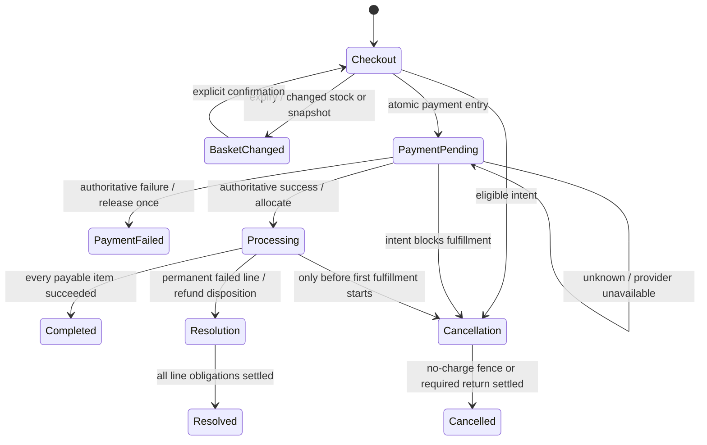

# Workflow diagrams

See [service ownership](SERVICE_ARCHITECTURE.md) for the deployed topology. Gateway routes client domain traffic to Commerce; Billing participates asynchronously and calls the private Bank simulator. Each owner commits only to its own database.

```mermaid
sequenceDiagram
    participant U as Customer
    participant G as API Gateway
    participant C as Commerce + SQL
    participant Q as RabbitMQ
    participant B as Billing + SQL
    participant K as Bank + SQL
    U->>G: POST order + bearer + stable key
    G->>C: Authenticated bounded request
    C->>C: Atomic admission + snapshot + hold + key + outbox
    C-->>U: Order ID / checkout revision / 5m expiry
    U->>G: Enter payment (expectedRevision)
    G->>C: Authenticated payment entry
    C->>C: Reacquire/check revision; promote payment-owned hold + outbox
    C-->>U: Locally accepted / payment pending
    C->>Q: PaymentRequested (confirm / retry same ID)
    Q->>B: Durable inbox handoff
    B->>B: Stable operation + scheduled recovery
    B->>K: Lookup/init/execute same operation key
    alt Transport uncertainty
        B->>B: UNKNOWN + increasing due time
        B->>K: Reconcile original operation
    end
    K-->>B: Authoritative terminal result
    B->>B: Result + attempt + status outbox commit
    B->>Q: Versioned payment status
    Q->>C: Durable inbox / guarded projection
    C->>C: Allocate stock + schedule typed items
    C->>C: Item effect + evidence + aggregate commit
    U->>G: Read current order
    G->>C: Owned read
    C-->>U: Current workflow / financial source version / effects
```



These conceptual nodes group several stored fields; they are not a replacement for the exact enums/versions in contracts. Order completion and financial summaries are separate: partial/full confirmed returns produce PARTIALLY_REFUNDED/REFUNDED, whereas unknown/pending returns remain outstanding.

```mermaid
sequenceDiagram
    participant A as Admin
    participant C as Commerce
    participant B as Billing
    participant K as Bank
    A->>C: Verified shortage + generation + reason + stable key
    C->>C: Parent/item lock; permanent disposition; block effect
    C->>C: Refund obligation + outgoing command in one commit
    C-->>B: Durable RefundRequested / same disposition identity
    B->>B: Captured-line / refundable budget guard
    B->>K: Lookup / return with stable refund identity
    K-->>B: Confirmed result or uncertainty
    B->>B: Attempts / due work / versioned result commit
    B-->>C: Durable refund status
    C->>C: Apply once; retain successful lines; financial summary
```

Cancellation and first-item start contend on the same Commerce parent lock. A winning cancellation fences delayed payment work; an uncertain charge remains protected until authoritative resolution and returns later success. Redis locks and RabbitMQ order are not correctness boundaries.
